# Análise experimental de desempenho — Issue #10

## 1. Objetivos e estado

Comparar multiplicação densa sequencial, OpenMP e MPI com medições reais,
estatísticas reproduzíveis e separação entre modelos e experimentos. A coleta
conjunta de 22/10/2026 foi executada no Docker: **175 observações**, 35 grupos,
cinco repetições por grupo, incluindo escalabilidade fraca. N=2048 é opcional
e permanece restrito à coleta OpenMP anterior; não há comparação conjunta nessa dimensão.

## 2. Implementações e inventário

O baseline original `codigos/baselines_sequenciais_CCO085/01_matmul.cpp`
permaneceu intacto. O OpenMP avaliado é `matmul_openmp.cpp`, variante `static`,
que distribui linhas por threads. `01_matmul_openmp.cpp` também está disponível
e passou na suíte de corretude, mas não integra os tempos desta coleta.
O MPI `matmul_mpi.cpp` distribui linhas com `Scatterv`, replica B com `Bcast`
e reúne C com `Gatherv`, equilibrando diferenças em até uma linha.

| Fonte em `resultados/` | Observações | Configurações e procedência |
|---|---:|---|
| `baseline_sequencial.csv` | 15 | N=256,512,1024; cinco repetições; Ryzen 5 3400G, Windows/MINGW64, 8 GB, GCC `-O2` |
| `benchmarks_automatizados.csv` | 5 | Sequencial N=256; ambiente não demonstrado |
| `openmp_desempenho.csv` | 240 | N=256,512,1024,2048; p=1,2,4,8; static/dynamic/guided; Intel i5-1334U, Docker/WSL2, 12 CPUs visíveis |
| `issue10_desempenho.csv` | 175 | Coleta conjunta comparável forte/fraca descrita abaixo |
| `openmp_resumo.csv` | 48 agregados | Não convertido em repetições nem duplicado |
| `openmp_status.csv` | 48 status | Não tratado como tempo |

Total consolidado: **435 observações individuais e 87 grupos estatísticos**.
Todos os tempos são segundos; não houve conversão de unidades nem exclusão de
outliers. Não havia CSV MPI antes desta Issue. O formato preparado em
`benchmark_mpi.sh` foi inspecionado: `implementacao,n,processos,repeticao,
tempo_s,checksum,status`, com etapas MPI adicionais. O analisador aceita esse
formato sem depender do nome do arquivo.

O histórico sequencial está em [perfilamento_sequencial.md](perfilamento_sequencial.md)
e o histórico OpenMP possui [metadados](../resultados/openmp_ambiente.txt).
As máquinas são diferentes: esses conjuntos ficam separados e não entram no
numerador do speedup da coleta nova. `openmp_resumo.csv` usava uma thread como
referência; essa métrica não é o speedup principal desta Issue.

## 3. Ambiente experimental da coleta conjunta

Serviço `pp-lab`, Ubuntu 24.04 sobre Linux 6.6.87.2/WSL2. `lscpu` informou
**Intel Core i7-4770S @ 3,10 GHz**, oito CPUs lógicas, topologia virtual de
quatro núcleos com duas threads. Isso descreve os recursos expostos, sem garantir
inventário físico ou exclusividade. Afinidade/cpuset 0–7, quota CPU ilimitada
visível, memória disponível inicial 7.654.547.456 bytes (aproximadamente 7,13 GiB).
Oito trabalhadores respeitam as CPUs lógicas e não equivalem a oito núcleos físicos.

GCC 13.3.0, Open MPI 4.1.6. Flags comuns `-O2 -std=c++17 -Wall -Wextra
-Wpedantic`, ligação `-lm`; OpenMP acrescenta `-fopenmp` e
`-DMATMUL_BENCH_SCHEDULE=static`. Houve avisos nos bindings C++ do cabeçalho do
Open MPI, sem erro de compilação. O Dockerfile não foi alterado.

OpenMP: `OMP_DYNAMIC=FALSE`, `OMP_PROC_BIND=close`, `OMP_PLACES=threads`,
`OMP_WAIT_POLICY=PASSIVE`, `OMP_THREAD_LIMIT=8`. MPI: `mpirun
--use-hwthread-cpus --bind-to hwthread -np p`. Não houve oversubscription nos
benchmarks; a suíte anterior pode usá-la em casos pequenos de corretude.
As afinidades dos runtimes não são idênticas, limitando atribuir as diferenças
exclusivamente ao paradigma.

Os [metadados da coleta](../resultados/issue10_desempenho_ambiente.txt) registram
instantes UTC, CPU, compiladores, recursos, flags, variáveis, launcher, checksums,
suíte e hashes SHA-256. O [manifesto](../resultados/analise_manifesto.json)
identifica fontes por SHA-256, avisos e a lista exata dos gráficos gerados.

## 4. Metodologia e tratamento

Forte: N=256,512,1024; sequencial p=1, OpenMP/MPI p=1,2,4,8.
Fraca: série separada N_base=256, N(p)=round(256 p^(1/3)). Houve um aquecimento
por configuração e cinco rodadas válidas, intercalando todos os casos com
embaralhamento determinístico (semente 8510). Aquecimentos não entram no CSV.
Execuções sequenciais extras obtêm checksums de cada N; seus tempos não entram
nas estatísticas.

A suíte anterior passou com **142 PASS, 0 FAIL, 0 SKIP**. Cada medição nova teve
checksum finito comparado ao sequencial da mesma dimensão; OpenMP teve equipe
efetiva conferida. Tolerância: `abs(a-b) <= 1e-6 + 1e-9 max(abs(a),abs(b))`.
Checksums não substituem a comparação elemento a elemento dos casos pequenos
da suíte. Nenhuma estimativa ou média virou observação.

O tempo sequencial cobre a multiplicação. OpenMP inclui entrada/sincronização
da região paralela. MPI inclui distribuição, broadcast, computação, reunião e
esperas, usando o máximo entre ranks. Alocação, inicialização, checksum, Python
e partida de processo/launcher ficam fora. O speedup MPI incorpora os custos
de comunicação do algoritmo, sem medir a latência total da invocação.

O analisador descobre CSVs recursivamente, valida colunas/valores e rejeita
repetições duplicadas, tempos não positivos, NaN/inf, equipes incoerentes e
checksums divergentes. Cópias de arquivos idênticos são reconhecidas por hash.
Cada arquivo de coleta fica isolado; a coluna `ambiente`, quando presente,
subdivide esse isolamento. Não se infere compatibilidade por checksums iguais.
Cópias parciais com nova procedência exigem revisão humana: igualdade de valores
não prova duplicação experimental.

O consolidado preserva arquivo, linha, metadados e o registro completo em JSON
na coluna `dados_originais`, incluindo tentativa, ordem e etapas MPI quando
presentes. Resumos e produtos da análise não são ingeridos como observações.
CSV desconhecido gera aviso. Originais nunca são sobrescritos. O coletor exige
caminho novo e preserva medições válidas com estado FAIL em caso de interrupção.

Calculam-se média, mediana, mínimo, máximo, desvio-padrão amostral (n−1) e
CV=100 sd/média. Com uma observação, sd/CV ficam vazios; menos de cinco gera
aviso. Não há descarte de outliers. A mediana é a comparação principal.
Os CSVs preservam a precisão; as tabelas arredondam só a apresentação.

## 5. Tempos consolidados

Medianas em segundos da coleta conjunta, cinco observações por célula.

| N | Sequencial | OpenMP p=1 | p=2 | p=4 | p=8 | MPI p=1 | p=2 | p=4 | p=8 |
|---:|---:|---:|---:|---:|---:|---:|---:|---:|---:|
| 256 | 0,011404 | 0,010977 | 0,005902 | 0,004785 | 0,004228 | 0,010660 | 0,006122 | 0,005686 | 0,004921 |
| 512 | 0,085741 | 0,101405 | 0,056621 | 0,033582 | 0,029449 | 0,091818 | 0,054075 | 0,047667 | 0,065587 |
| 1024 | 1,043835 | 0,912507 | 0,522553 | 0,322968 | 0,274365 | 0,953225 | 0,593915 | 0,513422 | 0,652208 |

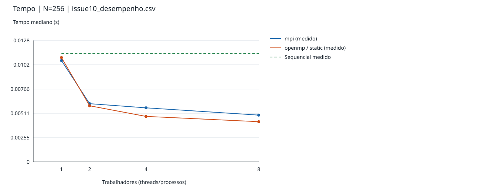
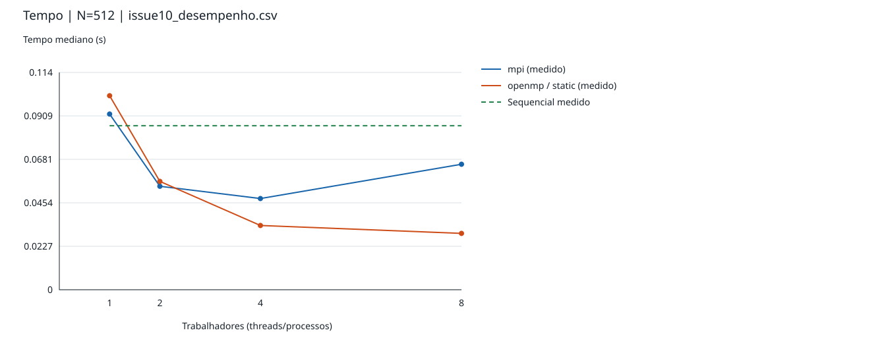
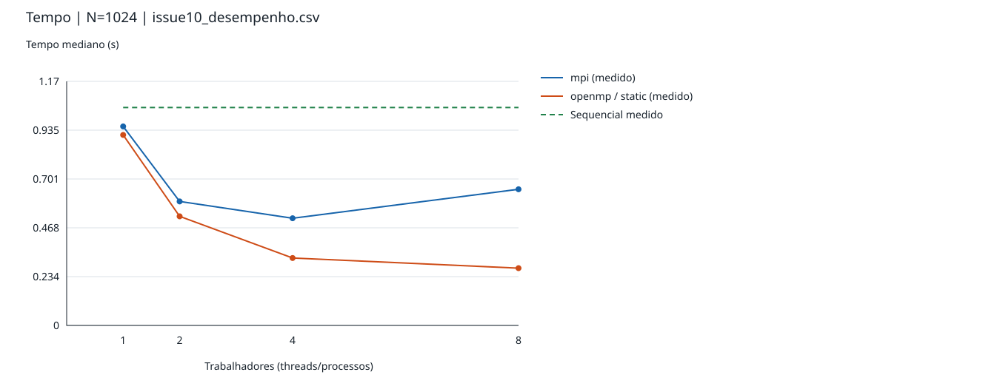

As fontes históricas têm gráficos próprios. O baseline antigo teve medianas
0,004798, 0,049412 e 0,542017 s; o sequencial N=256 sem ambiente identificado
teve 0,005328 s. São descrições das respectivas coletas, sem comparação conjunta.

## 6. Speedup e eficiência

`S(p)=mediana(Tseq)/mediana(Tp)` e `E(p)=S(p)/p`. O numerador usa o programa
sequencial original na mesma coleta, dimensão e experimento. Sem referência
compatível, campos ficam vazios. As colunas `speedup_relativo_1` e
`eficiencia_relativa_1` identificam separadamente a referência de uma
thread/processo da própria implementação/schedule.

| N | p | S OpenMP | E OpenMP (%) | S MPI | E MPI (%) |
|---:|---:|---:|---:|---:|---:|
| 256 | 1 | 1,039 | 103,9 | 1,070 | 107,0 |
| 256 | 2 | 1,932 | 96,6 | 1,863 | 93,1 |
| 256 | 4 | 2,383 | 59,6 | 2,006 | 50,1 |
| 256 | 8 | 2,697 | 33,7 | 2,317 | 29,0 |
| 512 | 1 | 0,846 | 84,6 | 0,934 | 93,4 |
| 512 | 2 | 1,514 | 75,7 | 1,586 | 79,3 |
| 512 | 4 | 2,553 | 63,8 | 1,799 | 45,0 |
| 512 | 8 | 2,912 | 36,4 | 1,307 | 16,3 |
| 1024 | 1 | 1,144 | 114,4 | 1,095 | 109,5 |
| 1024 | 2 | 1,998 | 99,9 | 1,758 | 87,9 |
| 1024 | 4 | 3,232 | 80,8 | 2,033 | 50,8 |
| 1024 | 8 | 3,805 | 47,6 | 1,600 | 20,0 |

Valores acima de 100% não foram truncados. Em p=1, código gerado, memória e
variação temporal podem produzir S diferente de 1, sem comprovar
superlinearidade causada por paralelismo. E não mede utilização de CPU.

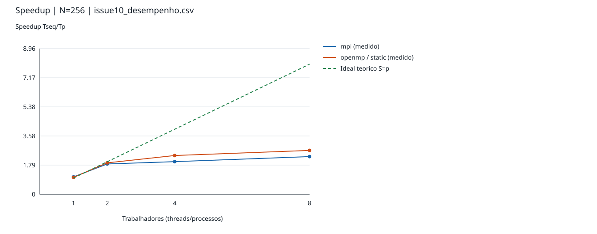
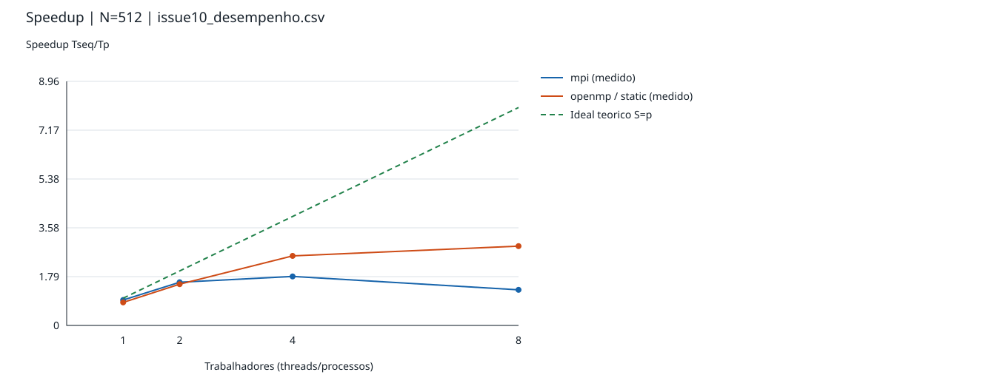
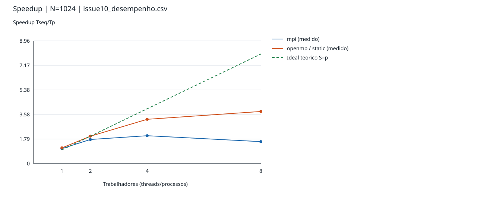
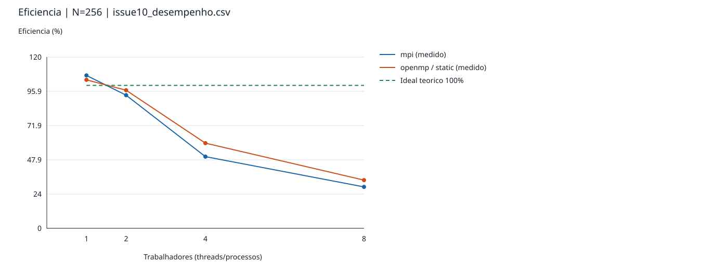
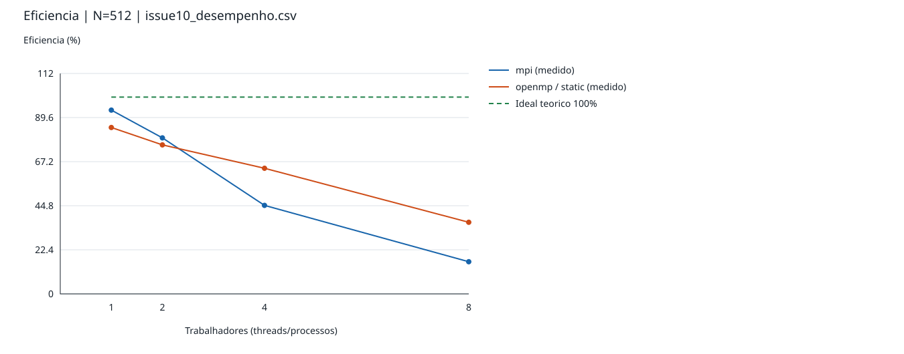
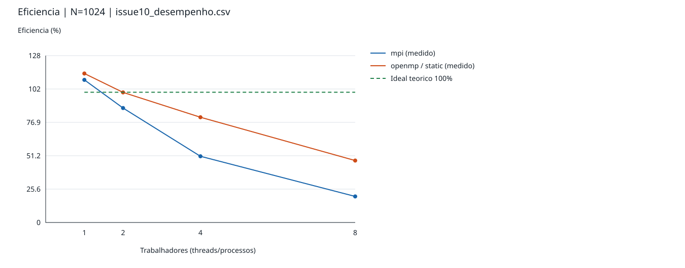

## 7. Escalabilidade forte

N=256: ambas têm menor mediana com oito trabalhadores, mas os ganhos marginais
caem. OpenMP passa de S=1,93 em p=2 para 2,70 em p=8; MPI de 1,86 para 2,32.
O CV MPI/p=8 é 57,9%, com tempos de 0,003895 a 0,012576 s: alta dispersão
limita a interpretação da mediana.

N=512: OpenMP reduz a mediana em todos os aumentos de equipe, chegando a
S=2,91 em p=8. MPI tem mínimo em p=4 (0,047667 s); oito processos sobem para
0,065587 s. Não há ganho monotônico ao aumentar processos nessa dimensão.

N=1024: OpenMP chega a S=3,80 e E=47,6% em p=8; quatro threads oferecem
S=3,23 e E=80,8%. MPI tem mínimo em p=4, S=2,03; oito reduzem S para 1,60.
As escolhas dependem de tamanho e ambiente e não são extrapoladas para clusters.

OpenMP foi mais rápido nos pares p=4/8 dos três tamanhos, mas MPI foi
ligeiramente mais rápido em N=512/p=2. Cinco amostras e dispersão não demonstram
superioridade estatística universal. O histórico i5 mostra dependência de N e
schedule, mas não entra nas métricas conjuntas nem ordena máquinas por eficiência.

## 8. Escalabilidade fraca

Experimentos próprios, com tempos distintos dos usados na análise forte.
Trabalho por trabalhador proporcional a N³/p; arredondamento ao inteiro mais
próximo por `round` do Python.

| p | N ideal | N executado | N − N ideal | Trabalho relativo N³/(p N_base³) |
|---:|---:|---:|---:|---:|
| 1 | 256,0000 | 256 | 0,0000 | 1,000000 |
| 2 | 322,5398 | 323 | +0,4602 | 1,004287 |
| 4 | 406,3747 | 406 | −0,3747 | 0,997237 |
| 8 | 512,0000 | 512 | 0,0000 | 1,000000 |

`E_fraca(p)=T(N_base,1)/T(N(p),p)` usa uma thread/processo da própria
implementação na série fraca. `S_escalado=p E_fraca` é uma métrica separada.

| p | N | OpenMP mediana (s) | E fraca (%) | MPI mediana (s) | E fraca (%) |
|---:|---:|---:|---:|---:|---:|
| 1 | 256 | 0,011348 | 100,00 | 0,011470 | 100,00 |
| 2 | 323 | 0,015655 | 72,49 | 0,011949 | 95,99 |
| 4 | 406 | 0,019154 | 59,25 | 0,022296 | 51,44 |
| 8 | 512 | 0,025753 | 44,06 | 0,061093 | 18,77 |

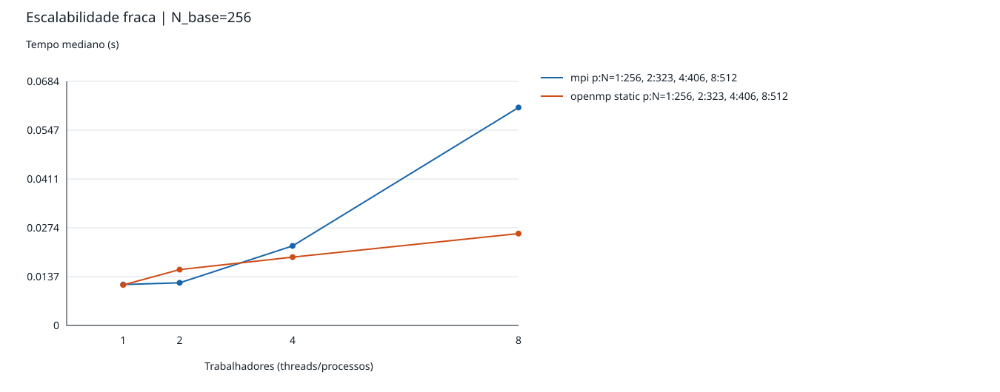

O tempo cresce: em p=8, E fraca foi 44,1% no OpenMP e 18,8% no MPI. O pequeno
erro de arredondamento (menos de 0,43%) não afasta efeitos de memória, afinidade,
comunicação e interferência, sem identificar qual domina. O CV MPI/p=8 foi
33,8%; MPI/p=2 e OpenMP/p=2 também excederam 30%.

Trabalho aritmético constante não implica memória constante por trabalhador.
A B replicada no MPI cresce como N² em cada rank; coletivas também mudam de
custo. Não se extrapola esta série para múltiplos nós.

## 9. Lei de Amdahl

`S_Amdahl(p)=1/(f+(1-f)/p)`. Usam-se cenários **hipotéticos**, sem ajuste,
f=0,05, 0,10 e 0,20. Tracejados são referências, marcadores são dados agregados.
Nenhuma curva é registrada como medição experimental.

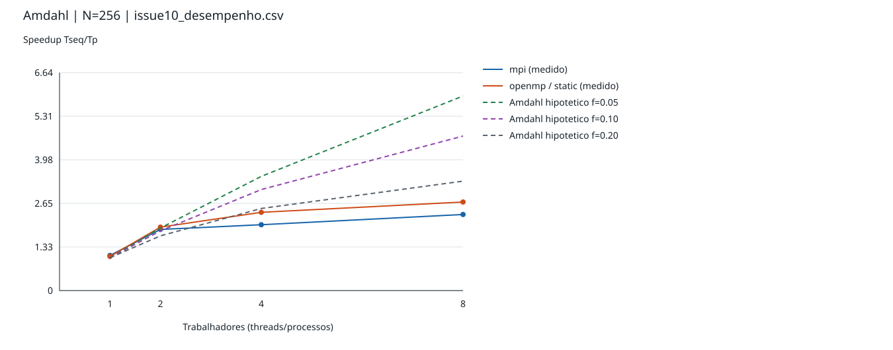
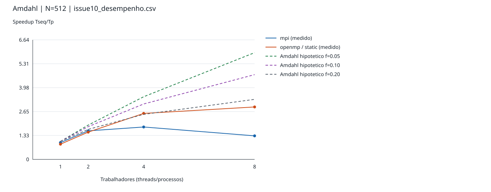
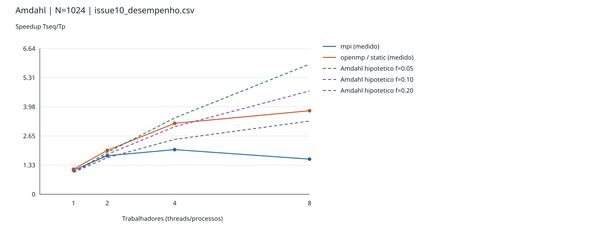

Em p=8, os cenários dão S=5,926, 4,706 e 3,333. OpenMP N=1024 (3,805) fica
entre f=0,10/0,20; OpenMP N=256/512 e todos os MPI/p=8 ficam abaixo do cenário
f=0,20. Isso não estima a fração sequencial real. O modelo de problema fixo
não descreve custos variáveis de memória/comunicação ou regressão MPI entre
p=4/8. Também prevê S(1)=1, enquanto implementações distintas e ruído podem
produzir outro valor. Não se aplica diretamente à série fraca, cujo problema cresce.

## 10. Gargalos possíveis e limitações

Os vetores são contíguos row-major; i-k-j reutiliza A[i,k] e percorre linhas
B/C, favorecendo localidade espacial/temporal. Isso é propriedade do código;
não medimos cache misses nem largura de banda. Em N=1024, B ocupa 8 MiB,
igual ao L3 total informado, além das demais matrizes/dados concorrentes.
Pressão sobre cache/memória é hipótese plausível, sem prova de saturação.

OpenMP divide linhas de trabalho regular. Criação e sincronização de threads,
barreiras, recursos compartilhados e SMT podem limitar os ganhos. Só static
foi reavaliado no ambiente novo; outras políticas permanecem no histórico.
Não há medição separada de overhead, contenção ou temperatura.

MPI foi executado em memória compartilhada numa máquina, sem rede entre nós.
Scatterv/Bcast/Gatherv e esperas entram no total. Na série fraca, N=323/p=2
distribui 162/161 linhas e N=406/p=4 distribui 102/102/101/101; os casos fortes
são divisíveis. Equilíbrio de linhas não garante igualdade de tempo. A coleta
conjunta não registra etapas MPI separadamente: não quantificamos quanto da
regressão é comunicação. O benchmark MPI anterior permite essa investigação futura.

Cinco repetições, virtualização compartilhada, saída com resolução de
microssegundos, ausência de intervalos de confiança e afinidades diferentes
limitam as conclusões. Queda de speedup não comprova gargalo de cache, memória,
comunicação ou temperatura. Não houve coleta conjunta N=2048 nem teste em cluster.

## 11. Reprodução e conclusão

Somente analisar dados existentes, sem executar benchmarks:

```bash
make analyze-performance
docker compose run --rm pp-lab make analyze-performance
python3 scripts/analisar_desempenho.py
```

Coletar novos dados, exigindo destino inédito:

```bash
docker compose run --rm pp-lab make collect-performance BENCHMARK_ARGS='--output resultados/coleta_nova_desempenho.csv'
# Opcionais: --sizes 256 512 1024 2048 --workers 1 2 4 8
# --repetitions 5 --weak-base 256 --seed 8510
```

O coletor reutiliza detecção de recursos e parser/suíte anteriores. A nova
orquestração é necessária: o benchmark OpenMP anterior só obtinha checksum
sequencial, sem gravar repetições de Tseq; o MPI anterior não coleta OpenMP ou
série fraca intercalada. Os scripts anteriores foram preservados.

O analisador aceita `--input-dir` e `--output-dir`, grava três CSVs e manifesto,
e gera **21 SVGs** sem dependências externas: 13 conjuntos (quatro tipos por N e
um de fraca), quatro do histórico OpenMP e quatro sequenciais isolados.
Cada gráfico tem título, eixos, unidades, legenda e referências identificadas.
O manifesto enumera os gráficos da execução atual; arquivos antigos fora da
lista não devem ser interpretados como resultados atuais.

Depois de novas medições, repita `make analyze-performance`. CSVs/SVGs são
recalculados sem alterar brutos. Este documento é uma fotografia da coleta
`issue10_desempenho.csv`; atualize tabelas e discussão ao relatar novas coletas,
sem substituir silenciosamente sua procedência.

```bash
docker compose run --rm pp-lab python3 -m unittest discover -s tests -p test_analisar_desempenho.py -v
```

Os dados sustentam ganhos OpenMP até oito threads nos três tamanhos, com
redução de eficiência; MPI piora de quatro para oito processos em N=512/1024.
A série fraca foi medida e mostrou crescimento de tempo em ambos. São
conclusões locais, sem prova de causa dos gargalos ou superioridade geral.

## Situação dos critérios 1–17

| Critério | Situação e evidência |
|---|---|
| 1. Inspeção | Concluído: fontes, scripts, CSVs, docs, Makefile, Docker e testes |
| 2. Sistema | Concluído: Python padrão, validação, estatísticas e SVG |
| 3. Consolidação | Concluído: 435 observações com procedência e isolamento |
| 4. Metodologia | Concluído: 175 novas medições, cinco repetições, aquecimento, checksums e ordem intercalada |
| 5. Speedup | Concluído: Tseq original na mesma coleta; métricas relativas separadas |
| 6. Eficiência | Concluído: S/p, decimal e percentual, sem truncamento |
| 7. Forte | Concluído: três N, quatro equipes, OpenMP e MPI |
| 8. Fraca | Concluído: série própria, arredondamento e métricas |
| 9. Amdahl | Concluído: três cenários hipotéticos e discussão de limites |
| 10. Gráficos | Concluído: cinco categorias, SVGs e históricos separados |
| 11. CSVs | Concluído: consolidado, métricas e fraca reproduzíveis |
| 12. Gargalos | Concluído como discussão de hipóteses; perfilamento específico não realizado |
| 13. Documento | Concluído: tabelas, gráficos, metodologia e limites |
| 14. Integração | Concluído: alvos distintos de análise e coleta |
| 15. Ausências | MPI medido; lacunas históricas preservadas sem referência artificial |
| 16. Restrições | Algoritmos, inicialização, Dockerfile e resultados anteriores preservados |
| 17. Validação | CSVs, cálculos, SVGs, links, testes e diff conferidos; limites descritos acima |
